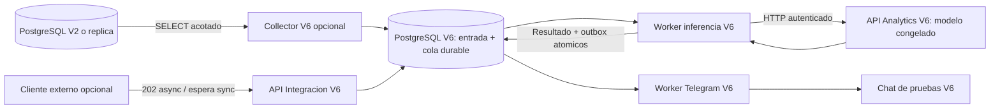

# Aislamiento y flujo

V2 no depende de ninguno de estos procesos. La caída de Analytics, Telegram o PostgreSQL V6 no bloquea los workers actuales. Solo el collector accede a la fuente, con una sesión de solo lectura y límites de tiempo; se puede apagar de forma independiente. No hay triggers, cambios en modelos ORM V2 ni reutilización de sus colas. El frontend no interviene.

La confirmación de recepción ocurre después del commit de entrada. La confirmación de inferencia ocurre junto con la creación de outbox. La confirmación Telegram se registra solo con `ok=true` y `message_id`. La incertidumbre de entrega no se presenta como envío confirmado.

Los leases y tokens impiden que un trabajador antiguo guarde un resultado tras perder su turno. SKIP LOCKED permite consumidores separados sin bloquear otros trabajos. Una clave de idempotencia con cuerpo diferente es un conflicto, no una actualización silenciosa del snapshot.

La política actual de notificación usa la señal congelada y un chat de pruebas. El mensaje no muestra el umbral, pero este se conserva para auditoría. El score sin calibrar no se describe como frecuencia real de ocurrencia.

## Retirada

Detener los perfiles collector/telegram, exportar la base nueva, ejecutar `ops.ps1 -Action Remove`. El volumen permanece hasta su eliminación explícita. La cuenta fuente V6 puede retirarse después de cerrar su conexión; las cuentas y tablas de la aplicación actual permanecen independientes. Eliminar imágenes/volumen únicamente por sus nombres V6, nunca por prune global.
